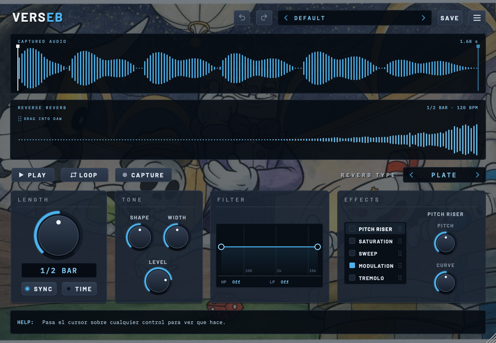

# Verseb

Plugin de **reverb inversa** para crear la entrada de una frase (vocal, lead, etc.). Capturas el audio, seleccionas el tramo y Verseb genera el "swell" que termina exactamente donde empieza la frase, listo para arrastrarlo al DAW. Misma base que Vultur: JUCE fijado, VST3/AU/Standalone, preview real y CI.



## Flujo

1. **CAPTURE**: graba la entrada del plugin (máx. 30 s). Pulsa de nuevo para detener; se recorta el silencio inicial/final. También puedes **soltar un WAV/AIFF/FLAC/MP3** sobre la ventana o usar *Menú → Cargar audio*.
2. **Selecciona el tramo** en *Captured Audio*: arrastra para crear la selección, arrastra los bordes para ajustarla, clic mueve el inicio, Shift+arrastrar desplaza el tramo, doble clic selecciona todo.
3. Ajusta longitud, tipo de reverb, tono, filtro y efectos; el render se rehace solo en segundo plano.
4. **PLAY** escucha la reverb inversa seguida del tramo (LOOP para repetir).
5. **DRAG INTO DAW**: arrastra el panel *Reverse Reverb* a la pista y colócalo para que termine donde empieza la frase. También puedes exportar el WAV desde el menú (solo reverb, o reverb + frase).

## Cómo se genera

Se invierte el inicio de la frase, se convoluciona (FFT) con una respuesta al impulso sintética cuya duración es la longitud elegida, se conserva la cola y se vuelve a invertir. Así el último sample del swell coincide con el primero de la frase. Cadena: reverb → filtro → efectos (en el orden de la lista) → anchura → nivel. El pico se normaliza a −1 dBFS antes de **LEVEL**.

## Controles

- **Length**: SYNC en compases (1/16 a 4 BARS, compás del host; 4/4 por defecto) o TIME en segundos (0.05–12 s). Tempo del host; sin host, arrastra verticalmente el BPM del panel *Reverse Reverb*.
- **Reverb type**: Plate, Hall, Room, Chamber, Spring, Cathedral (pre-delay, reflexiones, amortiguación y dispersión distintas).
- **Tone**: SHAPE (curva del crescendo), WIDTH (0–200 %), LEVEL (−24 a +6 dB).
- **Filter**: HP/LP de 24 dB/oct, arrastrando los puntos; doble clic = Off.
- **Effects** (casilla activa, clic edita, arrastrar reordena): Pitch Riser (sube hasta el tono original al llegar a la frase), Saturation, Sweep (low-pass que se abre), Modulation (chorus), Tremolo.
- **Presets** de fábrica y de usuario (`SAVE`, en `~/Library/Application Support/Verseb/Presets`), **undo/redo**, menú con exportar, limpiar y tamaño de ventana (75–200 %, también redimensionable).
- **HELP**: la barra inferior describe el control bajo el cursor.

El audio capturado (FLAC) y la selección se guardan en el proyecto del host. El plugin deja pasar la entrada intacta; solo suma la escucha previa cuando PLAY está activo.

## Compilación

Igual que Vultur (CMake ≥ 3.22, C++17, Xcode en macOS):

```bash
bash scripts/build.sh
# reutilizando CMake y JUCE de FindNote:
CMAKE_BIN=/Users/luis/Projects/Personal/findnote/.tools/venv/bin/cmake JUCE_SOURCE=/Users/luis/Projects/Personal/findnote/build/_deps/juce-src bash scripts/build.sh
```

Salidas: `build/Verseb_artefacts/Release/{VST3/Verseb.vst3, AU/Verseb.component, Standalone/Verseb.app}` y la captura `docs/images/verseb.png`. Interfaz interactiva sin audio:

```bash
open "build/VersebPreview_artefacts/Release/Verseb Preview.app" --args --show
```

`scripts/build.py`, `release.config.cjs` y `.github/workflows/build-release.yml` son los de Vultur renombrados (CI macOS arm64/Intel + Windows, semantic-release, firma/notarización en `main`).

## Pruebas

`Tests/RendererTests.cpp` (CTest): convolución FFT frente a la directa, longitud exacta del swell, crecimiento hacia la frase, normalización, todos los tipos y efectos acotados a 44.1/48/96 kHz, anchura mono, nivel, longitud sincronizada, paso de audio intacto, captura, render en segundo plano, guardado/restauración del estado (audio, selección, orden de efectos), presets y undo.

## Recursos

- `assets/wallpaper.jpg`: fondo aportado por el usuario.
- `assets/fonts/`: Barlow e IBM Plex Mono (SIL OFL 1.1, licencias incluidas y copiadas en los paquetes).
- La interfaz sigue la maqueta de referencia; se retiró la marca del fabricante original y el producto se llama Verseb.
